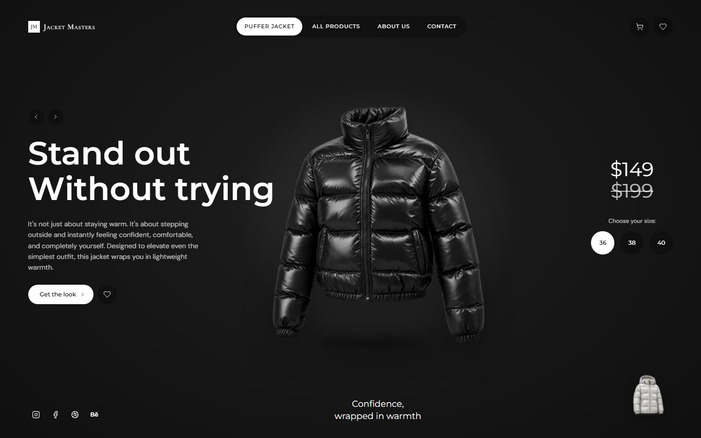
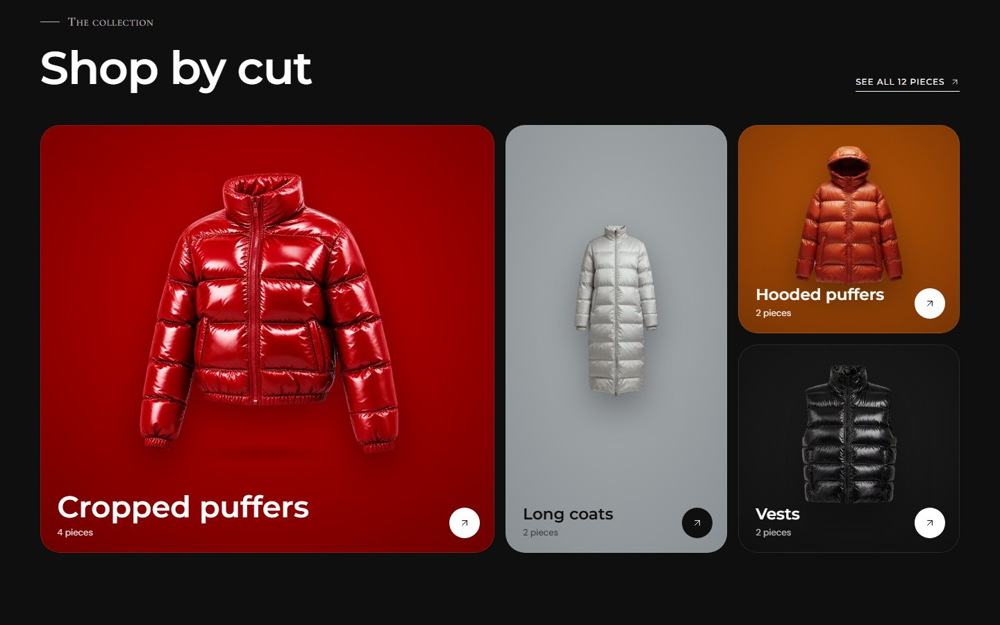
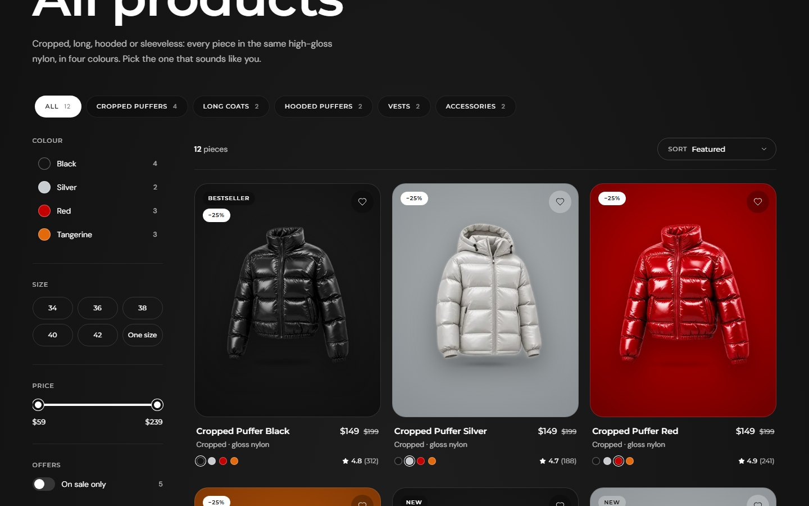
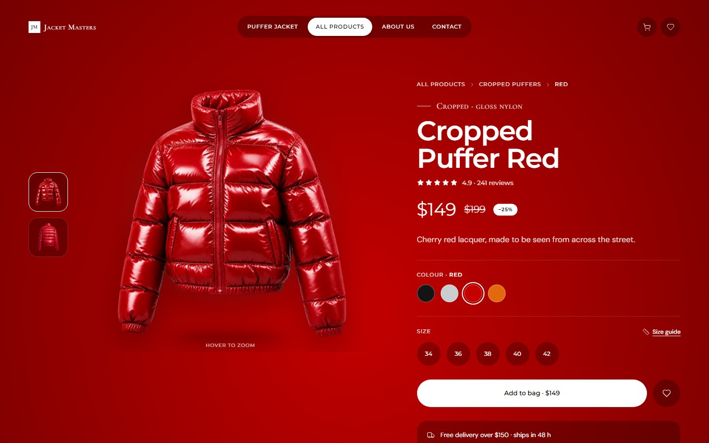
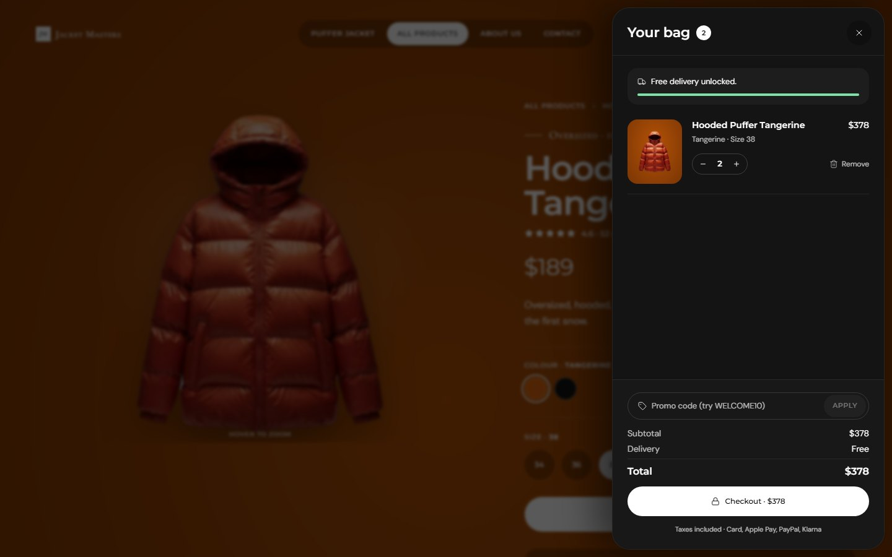
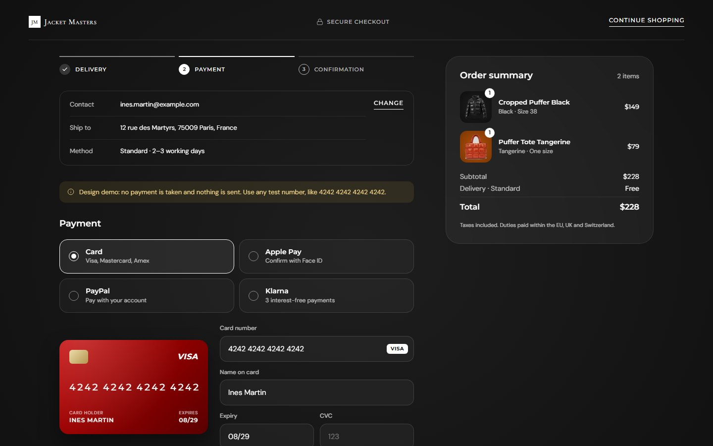
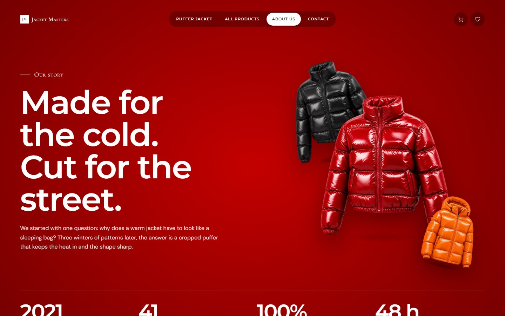
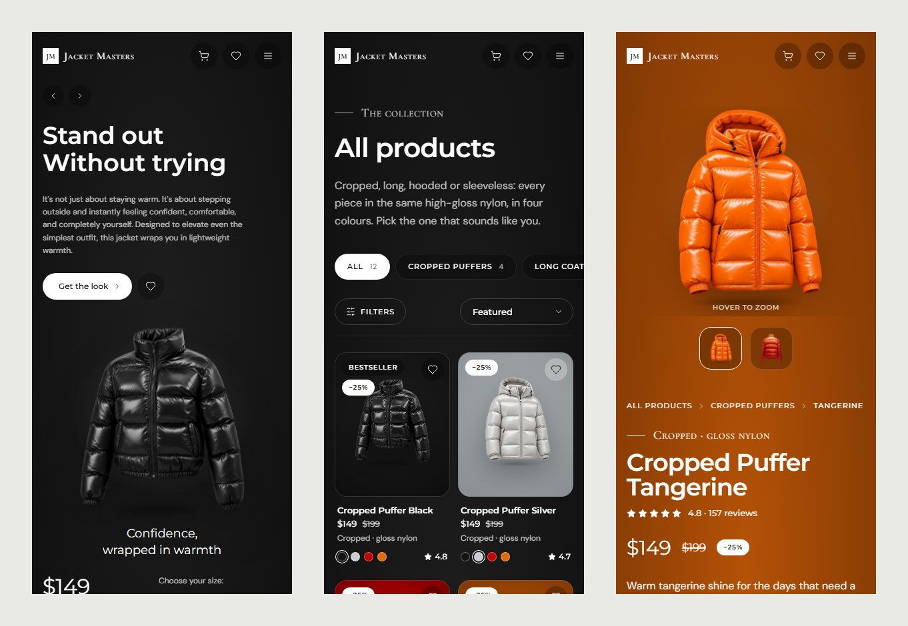

# Jacket Masters

A front-end concept store for a fictional brand of glossy puffer jackets: twelve products, four colourways, and every screen of an online shop, from the hero to the order confirmation. Design and front-end only — there is no back end, nothing is sold and no data leaves the browser.

**Live demo:** _add your Vercel URL here_



| | |
|---|---|
|  |  |
|  |  |
|  |  |



## What's inside

- **Colourway theming** — one `data-theme` attribute recolours a whole page; gradients blend between colourways through CSS `@property`. Text colours are tuned per theme to pass WCAG AA.
- **Hero reel** — GSAP-driven jacket swaps, mouse parallax, autoplay, keyboard and swipe.
- **Catalogue** — category tabs, colour / size / price / sale filters with live counts, sorting, all kept in the URL; cards glide to their new place with GSAP Flip.
- **Product page** — gallery with hover zoom, colourway swatches, size validation, size guide in a native `<dialog>` (cm / in), accordions, reviews with rating distribution and fit, related products, sticky mobile buy bar.
- **Bag & wishlist** — side drawers, quantities, free-delivery progress, promo code (`WELCOME10`), toasts.
- **Checkout** — three steps with inline validation, delivery options, a live card preview that flips for the CVC, a fake processing state and an order confirmation. "Try with a sample bag" lets anyone walk through it.
- **About, Contact, 404** — timeline, values, a contact form with conditional fields, FAQ, and a 404 whose zero is a jacket you can recolour.
- **Motion with manners** — scroll reveals, page transitions with the View Transitions API (the product photo morphs from card to page), all switched off for `prefers-reduced-motion`.
- **Accessibility** — skip link, focus rings, labelled dialogs with focus management, live regions for cart updates, keyboard-operable tabs and radio groups.

## Stack

Next.js 16 (pages router, static export-friendly) · React 19 · TypeScript · GSAP (+ Flip) · lucide-react · hand-written CSS with design tokens (Tailwind is only used for its reset).

## Run it

```bash
npm install
npm run dev        # http://localhost:3000
npm run build && npm start
```

## Deploy

Import the repository in [Vercel](https://vercel.com/new) — no configuration needed. Set `NEXT_PUBLIC_SITE_URL` (e.g. `https://jacket-masters.vercel.app`) so share previews use an absolute image URL.

## Credits

Brand, copy, reviews, people and contact details are fictional. Product photos were generated with AI (Magnific) and cut out for the site. Typefaces: Montserrat, DM Sans, Cormorant Garamond (SIL Open Font License).
